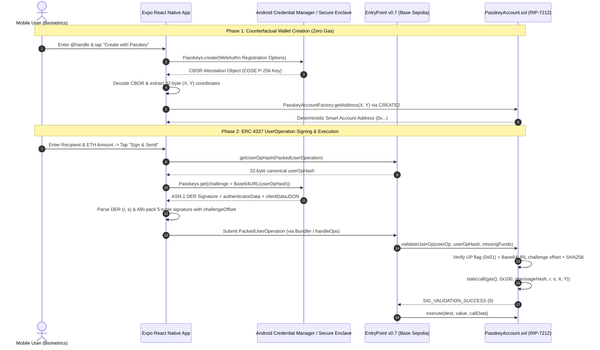
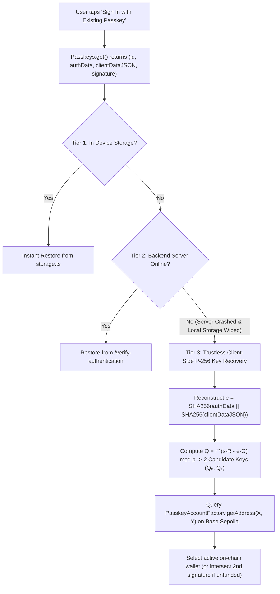

# Keyless ERC-4337 Passkey Smart Wallet (RIP-7212 on Base Sepolia)


-10B981)

-0052FF)

A non-custodial, hardware-secured **ERC-4337 Account Abstraction mobile wallet** built with **React Native (Expo)**, **Solidity (Foundry)**, and **WebAuthn Passkeys (`secp256r1` / NIST P-256)** synced via **Google Credential Manager**.

Instead of vulnerable 12-word mnemonic seed phrases (`secp256k1`), this wallet generates hardware-bound **P-256 Passkeys** inside the mobile device's Secure Enclave / Titan M2 chip and verifies signatures directly on-chain using the **RIP-7212 Precompile (`0x0000...0100`)** on **Base Sepolia**.

---

## Why This Project Exists

| Traditional EOA Wallets (`secp256k1`) | This Passkey Smart Wallet (`ERC-4337` + `RIP-7212`) |
| :--- | :--- |
| Requires writing down a 12/24-word seed phrase | **Zero seed phrases** — authenticated via Fingerprint / FaceID |
| Private keys stored in app memory/storage | **Hardware-isolated keys** inside Secure Enclave / Android Keystore |
| Losing device = permanent loss of funds | **Cloud-synced recovery** via Google Password Manager / iCloud Keychain |
| Naive Solidity P-256 verification costs ~330,000 gas | **~3,450 gas verification** via inline Yul assembly calling `0x100` (RIP-7212) |
| Centralized passkey servers are a single point of failure | **Server-crash resilient** via client-side P-256 `ecrecover` (`Q = r⁻¹(sR - eG)`) |

---

## Deployed Contracts (Base Sepolia — Chain ID `84532`)

| Contract | Address | Role |
| :--- | :--- | :--- |
| **PasskeyAccountFactory** | [`0xBBC847b874985f7787E3B2756fB71Ca640bd57fF`](https://sepolia.basescan.org/address/0xBBC847b874985f7787E3B2756fB71Ca640bd57fF) | Deterministic `CREATE2` smart account factory (`keccak256(x, y)` salt) |
| **ERC-4337 EntryPoint v0.7** | [`0x0000000071727De22E5E9d8BAf0edAc6f37da032`](https://sepolia.basescan.org/address/0x0000000071727De22E5E9d8BAf0edAc6f37da032) | Canonical singleton EntryPoint v0.7 |
| **RIP-7212 Precompile** | `0x0000000000000000000000000000000000000100` | Native OP-Stack `secp256r1` P-256 signature verification precompile |

---

## System Architecture

### 1. Counterfactual Creation & ERC-4337 Transaction Lifecycle



---

### 2. Server-Crash Resilient Account Recovery (Trustless P-256 `ecrecover`)

A major architectural flaw in many WebAuthn wallets is how they handle **returning users on a new device**:
- `Passkeys.create()` (Registration) returns the public key `(X, Y)` inside `attestationObject`.
- `Passkeys.get()` (Sign-In) **does NOT return the public key**—it only returns `credentialId`, `authenticatorData`, `clientDataJSON`, and an ASN.1 DER signature `(r, s)`.

If a wallet relies solely on a backend database to map `credentialId -> (X, Y)` and that server crashes (or a user reinstalls the app on a new phone), the user cannot derive their smart account address.

This wallet solves that completely with a **3-Tier Recovery Waterfall** in [`useWallet.ts`](./src/hooks/useWallet.ts) and [`crypto.ts`](./src/utils/crypto.ts):



#### Mathematical Recovery of `(X, Y)` from `(r, s)`:
1. Reconstruct the signed WebAuthn message digest:
   $$e = \text{SHA256}(\text{authenticatorData} \parallel \text{SHA256}(\text{clientDataJSON}))$$
2. Because NIST P-256 (`secp256r1`) prime $p \equiv 3 \pmod 4$, we lift $x_R = r$ to the two possible curve points $R_0 = (r, y_R)$ and $R_1 = (r, p - y_R)$ via:
   $$y_R = (r^3 - 3r + b)^{(p+1)/4} \bmod p$$
3. Inverting the ECDSA verification equation yields at most **2 candidate public keys**:
   $$Q_i = r^{-1}(s \cdot R_i - e \cdot G) \pmod p$$
4. The app queries `PasskeyAccountFactory.getAddress(X, Y)` on Base Sepolia for both candidates. If either address has balance, code, or nonce $> 0$, it is selected immediately; if neither has been funded yet, a second signature intersection $\{Q_0^{(1)}, Q_1^{(1)}\} \cap \{Q_0^{(2)}, Q_1^{(2)}\}$ uniquely pinpoints the true hardware public key with **100% mathematical certainty and zero server dependency**.

---

## Cryptographic & Smart Contract Deep-Dive

### 1. CBOR / COSE Public Key Extraction ([`src/utils/crypto.ts`](./src/utils/crypto.ts))
During registration, Android/iOS returns a Base64URL-encoded CBOR `attestationObject`.
- We verify Bit 6 (`0x40` Attested Credential Data flag) in `authData[32]`.
- We read the big-endian `credIdLen` at byte `53`, slice the COSE key buffer at offset `55 + credIdLen`, and decode the CBOR map with `{ useMaps: true }` to extract negative integer keys `-2` (`X` coordinate) and `-3` (`Y` coordinate).

### 2. ASN.1 DER Unpacking & Dynamic Challenge Offset
Hardware enclaves output DER-encoded signatures (`0x30 [totalLen] 0x02 [rLen] [r] 0x02 [sLen] [s]`).
- `parseDERSignature()` parses the variable-length `r` and `s` bigints.
- `packPasskeySignature()` finds the exact byte offset of `Base64URL(userOpHash)` inside `clientDataJSON` so the smart contract does not have to run an expensive full-JSON parser on-chain.

### 3. Gas-Optimized Yul Assembly Verification ([`contracts/src/PasskeyAccount.sol`](./contracts/src/PasskeyAccount.sol))
```solidity
// 1. Hardware User Present (UP) bit check
if (authenticatorData.length < 37 || (uint8(authenticatorData[32]) & 0x01) == 0) {
    return false;
}

// 2. O(1) Slice Replay Protection at challengeOffset
string memory expectedChallengeStr = Base64.encodeURL(abi.encodePacked(userOpHash));
// ... verifies clientDataJSON[challengeOffset + i] == expectedChallenge[i]

// 3. Reconstruct WebAuthn SHA-256 digest & invoke RIP-7212 Precompile (0x100)
bytes32 clientDataHash = sha256(clientDataJSON);
bytes32 messageHash = sha256(abi.encodePacked(authenticatorData, clientDataHash));

assembly {
    let ptr := mload(0x40)
    mstore(ptr, messageHash)
    mstore(add(ptr, 0x20), r)
    mstore(add(ptr, 0x40), s)
    mstore(add(ptr, 0x60), localPubKeyX)
    mstore(add(ptr, 0x80), localPubKeyY)
    success := staticcall(gas(), 0x100, ptr, 0xA0, ptr, 0x20)
    result := mload(ptr)
}
```

---

## Project Structure

```text
├── contracts/                  # Foundry Smart Contracts (Solidity 0.8.28+)
│   ├── src/
│   │   ├── PasskeyAccount.sol        # ERC-4337 IAccount with RIP-7212 assembly verification
│   │   └── PasskeyAccountFactory.sol # CREATE2 deterministic account factory
│   └── script/
│       └── DeployFactory.s.sol       # Base Sepolia deployment script
├── server/                     # Optional Express + @simplewebauthn/server RP Backend
│   └── index.js                # Registration & Authentication WebAuthn endpoints
├── src/                        # Expo React Native Application
│   ├── app/
│   │   ├── _layout.tsx         # Expo Router root stack
│   │   ├── index.tsx           # Onboarding, Dashboard, Quick Send, Navigation
│   │   └── scan.tsx            # Camera QR Code Scanner for Ethereum/Base addresses
│   ├── components/
│   │   ├── ActivityList.tsx    # Filterable on-chain & UserOp transaction history
│   │   ├── ReceiveModal.tsx    # Blurred QR code modal & address copy
│   │   ├── SendModal.tsx       # 3-step ERC-4337 UserOp builder & Passkey signer
│   │   └── SettingsView.tsx    # Cryptographic identity, Bundler/Paymaster config
│   ├── constants/
│   │   ├── config.ts           # Chain config, contract addresses & ABIs
│   │   └── theme.ts            # Dark-mode UI palette
│   ├── hooks/
│   │   └── useWallet.ts        # Full wallet lifecycle, P-256 recovery & UserOp signing
│   └── utils/
│       ├── crypto.ts           # CBOR/COSE parser, DER parser, ABI packer & P-256 ecrecover
│       └── storage.ts          # Persistent cross-platform wallet state storage
└── assetlinks.json             # Android Digital Asset Links for Passkey RP binding
```

---

## Getting Started

### 1. Install Dependencies
```bash
npm install
```

### 2. Verify TypeScript Types
```bash
npx tsc --noEmit
```

### 3. Run the Mobile App
> **Important:** Native Hardware Passkeys (`react-native-passkeys`) require an Android (API 28+) or iOS (16+) development build rather than Expo Go, as the APK signing certificate SHA-256 fingerprint must match the Relying Party's `/.well-known/assetlinks.json`.

```bash
# Start Metro Bundler
npx expo start

# Or build & launch on a connected Android device
npx expo run:android
```

### 4. Broadcasting Live UserOperations via Bundler
Out-of-the-box, the app queries `EntryPoint v0.7` on Base Sepolia for the canonical `userOpHash` and signs it with your hardware Passkey. To broadcast live transactions to Base Sepolia:
1. Get a free **Base Sepolia Bundler RPC URL** from [Pimlico](https://dashboard.pimlico.io) or [Alchemy](https://dashboard.alchemy.com).
2. Open the **Settings** tab in the app and paste your **Bundler RPC URL** (and optional **Paymaster RPC URL** for gasless sponsorship).
3. Fund your counterfactual address via the Base Sepolia Faucet and tap **Send**!
