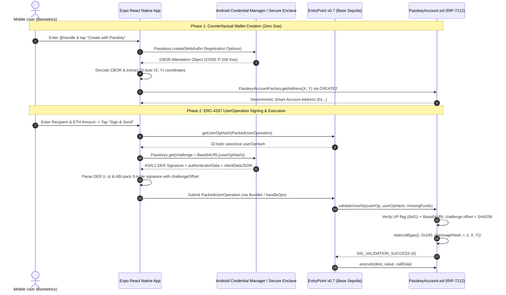
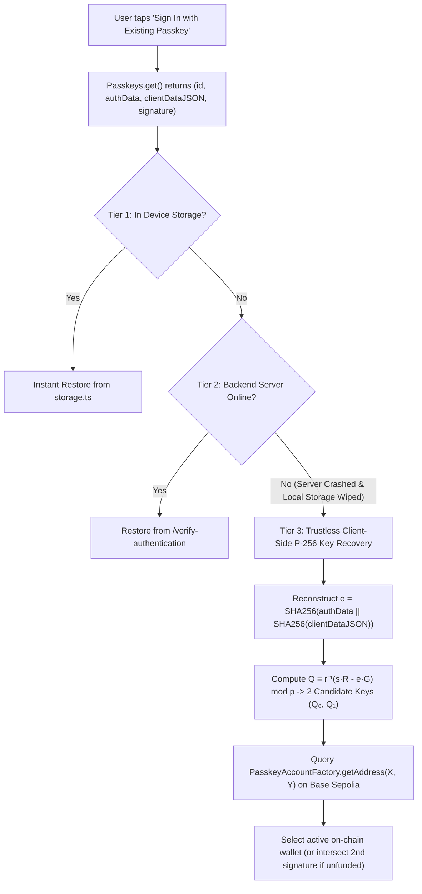

> **Note on `.env` in Repository:** I have explicitly allowed `.env` in this repository because this is a testnet showcasing project (Base Sepolia) and I wanted the complete code, configuration, and environment variables available in one place for reviewers. In production environments, I never push `.env` files or secrets to source control.

# Keyless ERC-4337 Passkey Smart Wallet (`RIP-7212` on Base Sepolia)


-10B981)

-0052FF)

A non-custodial, hardware-secured **ERC-4337 v0.7 Account Abstraction mobile wallet** built with **Solidity (Foundry)**, **React Native (Expo)**, **Viem**, and **WebAuthn Passkeys (`secp256r1` / NIST P-256)** synced via **Google Credential Manager**.

Instead of vulnerable 12-word mnemonic seed phrases (`secp256k1`), this wallet generates hardware-bound **P-256 Passkeys** inside the mobile device's Secure Enclave / Titan M2 chip and verifies signatures directly on-chain using the **RIP-7212 Precompile (`0x0000...0100`)** on **Base Sepolia** via inline **Yul assembly**.

---

## Why This Architecture Matters (The Web3 UX & Cryptography Gap)

 Ethereum natively uses the **`secp256k1`** elliptic curve (`ecrecover` at precompile `0x01`), whereas mobile hardware enclaves (Android Keystore, Apple Secure Enclave, FIDO2/WebAuthn Passkeys) exclusively use the **`secp256r1` (NIST P-256)** curve.

Historically, verifying a P-256 signature in Solidity cost **~330,000+ gas** per transaction—making hardware Passkey wallets economically unviable. By combining **ERC-4337 Account Abstraction (`EntryPoint v0.7`)** with the **RIP-7212 Precompile (`0x100`)** on OP-Stack chains (Base), we achieve hardware biometric signing for **~3,450 gas**.

| Traditional EOA Wallets (`secp256k1`) | This Passkey Smart Wallet (`ERC-4337` + `RIP-7212`) |
| :--- | :--- |
| Requires writing down a 12/24-word seed phrase | **Zero seed phrases** — authenticated via Fingerprint / FaceID |
| Private keys stored in app memory/storage | **Hardware-isolated keys** inside Secure Enclave / Android Keystore |
| Losing device = permanent loss of funds | **Cloud-synced recovery** via Google Password Manager / iCloud Keychain |
| Naive Solidity P-256 verification costs ~330,000 gas | **~3,450 gas verification** via inline Yul assembly calling `0x100` (RIP-7212) |
| Centralized passkey servers are a single point of failure | **Server-crash resilient** via client-side P-256 `ecrecover` (`Q = r⁻¹(sR - eG)`) |

---

## Live Deployed Contracts (Base Sepolia — Chain ID `84532`)

| Contract | Address | Role |
| :--- | :--- | :--- |
| **PasskeyAccountFactory** | [`0xBBC847b874985f7787E3B2756fB71Ca640bd57fF`](https://sepolia.basescan.org/address/0xBBC847b874985f7787E3B2756fB71Ca640bd57fF) | Deterministic `CREATE2` smart account factory (`keccak256(x, y)` salt) |
| **Deployment Transaction** | [`0x1f67186d...6d582fc0`](https://sepolia.basescan.org/tx/0x1f67186d4394b820dea49281cae1b6f67388b1e233caffb88086bb746d582fc0) | Verified Base Sepolia Factory deployment at Block `48,009,252` |
| **ERC-4337 EntryPoint v0.7** | [`0x0000000071727De22E5E9d8BAf0edAc6f37da032`](https://sepolia.basescan.org/address/0x0000000071727De22E5E9d8BAf0edAc6f37da032) | Canonical singleton EntryPoint v0.7 |
| **RIP-7212 Precompile** | `0x0000000000000000000000000000000000000100` | Native OP-Stack `secp256r1` P-256 signature verification precompile |

---

## End-to-End Architecture & Lifecycle

### 1. Counterfactual Creation & ERC-4337 UserOperation Flow



---

### 2. Server-Crash Resilient Account Recovery (Trustless Client-Side P-256 `ecrecover`)

A common architectural pitfall in WebAuthn smart wallets is how they handle **returning users on a new device**:
- `Passkeys.create()` (Registration) returns the public key `(X, Y)` inside the CBOR `attestationObject`.
- `Passkeys.get()` (Sign-In) **does NOT return the public key**—it only returns `credentialId`, `authenticatorData`, `clientDataJSON`, and an ASN.1 DER signature `(r, s)`.

If a wallet relies solely on a centralized server database to map `credentialId -> (X, Y)` and that server crashes (or the user switches phones), the user is locked out of their smart account address.

This wallet solves that completely with a **3-Tier Recovery Waterfall** in [`useWallet.ts`](./src/hooks/useWallet.ts) and [`crypto.ts`](./src/utils/crypto.ts):



#### Mathematical Derivation of `(X, Y)` from a WebAuthn Signature `(r, s)`:
1. Reconstruct the signed WebAuthn message digest:
   $$e = \text{SHA256}(\text{authenticatorData} \parallel \text{SHA256}(\text{clientDataJSON}))$$
2. Because NIST P-256 (`secp256r1`) field prime $p \equiv 3 \pmod 4$, we lift $x_R = r$ to the two candidate curve points $R_0 = (r, y_R)$ and $R_1 = (r, p - y_R)$ via modular exponentiation:
   $$y_R = (r^3 - 3r + b)^{(p+1)/4} \bmod p$$
3. Solving the ECDSA verification equation $R = s^{-1}(e \cdot G + r \cdot Q)$ for the public key $Q$ yields at most **2 candidate public keys**:
   $$Q_i = r^{-1}(s \cdot R_i - e \cdot G) \pmod p$$
4. The app queries `PasskeyAccountFactory.getAddress(X, Y)` on Base Sepolia for both candidates. If either address has balance, code, or nonce $> 0$, it is selected immediately; if neither has been funded yet, a second signature intersection $\{Q_0^{(1)}, Q_1^{(1)}\} \cap \{Q_0^{(2)}, Q_1^{(2)}\}$ uniquely pinpoints the true hardware public key with **100% mathematical certainty and zero server dependency**.

---

## Smart Contract Architecture (`PasskeyAccount.sol` & `PasskeyAccountFactory.sol`)

### 1. ERC-4337 `IAccount` Validation & Execution ([`contracts/src/PasskeyAccount.sol`](./contracts/src/PasskeyAccount.sol))
[`PasskeyAccount.sol`](./contracts/src/PasskeyAccount.sol) implements the standard ERC-4337 `IAccount` interface with strict access control and custom errors:
- **Singleton EntryPoint Guard (`onlyEntryPointCanCall`)**: Restricts both `validateUserOp()` and `execute()` exclusively to the canonical ERC-4337 v0.7 EntryPoint (`0x0000000071727De22E5E9d8BAf0edAc6f37da032`), reverting with `MsgSenderIsNotEntryPoint()` on unauthorized calls.
- **Automatic Gas Prefund Settlement**: During `validateUserOp()`, if `missingAccountFunds > 0` (when no Paymaster is sponsoring the operation), the smart account automatically transfers the required ETH prefund to `EntryPoint` before validating the WebAuthn Passkey signature.
- **Arbitrary Transaction Execution (`execute`)**: Allows the user's smart account to send native ETH or invoke any smart contract function on Base, bubbling up the target contract's exact revert bytes via `TransactionCannotBeCompleted(bytes result)` if an external call fails:

```solidity
function execute(
    address dest,
    uint256 value,
    bytes memory data
) external onlyEntryPointCanCall {
    (bool success, bytes memory result) = dest.call{value: value}(data);
    if (!success) {
        revert TransactionCannotBeCompleted(result);
    }
}

function validateUserOp(
    PackedUserOperation calldata userOp,
    bytes32 userOpHash,
    uint256 missingAccountFunds
) external onlyEntryPointCanCall returns (uint256) {
    if (missingAccountFunds > 0) {
        (bool success, ) = msg.sender.call{value: missingAccountFunds}("");
        if (!success) revert PrefundFailed();
    }

    bool result = _verification(userOp, userOpHash);
    return result ? SIG_VALIDATION_SUCCESS : SIG_VALIDATION_FAILED;
}
```

### 2. Counterfactual `CREATE2` Factory ([`contracts/src/PasskeyAccountFactory.sol`](./contracts/src/PasskeyAccountFactory.sol))
- **Zero-Gas Counterfactual Onboarding (`getAddress`)**: Computes the user's deterministic smart wallet address off-chain or via `eth_call` using `CREATE2` (`keccak256(0xff ++ factory ++ salt ++ keccak256(initCode))`) where `salt = keccak256(abi.encodePacked(publicKey_x, publicKey_y))`. Users can receive ETH at their address before the contract is even deployed on-chain.
- **Idempotent Lazy Deployment (`createAccount`)**: Checks `if (predictedAddress.code.length > 0)` and returns the existing `PasskeyAccount` without reverting if already deployed—satisfying ERC-4337 bundler simulation requirements when `initCode` is supplied on the first transaction.

---

## Foundry Smart Contract Test Suite (22/22 Passing)

The [`contracts/test/`](./contracts/test/) directory includes a comprehensive Foundry unit and fuzz test suite covering all contract functions, custom error reverts, access controls, `vm.signP256` real cryptographic signatures, and 512 fuzz runs:

- **[`contracts/test/PasskeyAccount.t.sol`](./contracts/test/PasskeyAccount.t.sol)** (17 tests):
  - Native ETH transfers, arbitrary contract calls with calldata, and inner revert bubbling (`TransactionCannotBeCompleted(bytes)`).
  - `EntryPoint` access control (`MsgSenderIsNotEntryPoint`) on both `execute()` and `validateUserOp()`.
  - Prefund settlement (`missingAccountFunds`) and `PrefundFailed()` revert conditions.
  - Real `secp256r1` signature generation via Foundry's `vm.signP256` cheatcode verified against `PasskeyAccount.validateUserOp`.
  - Security rejection tests for short `authenticatorData` (`< 37` bytes), missing `UP` flag (`0x01`), out-of-bounds `challengeOffset`, replayed/tampered `userOpHash`, and invalid ECDSA `(r, s)` coordinates.
  - 256-run fuzz test (`testFuzz_ValidateUserOpWithArbitraryHashesAndCoordinates`).
- **[`contracts/test/PasskeyAccountFactory.t.sol`](./contracts/test/PasskeyAccountFactory.t.sol)** (5 tests):
  - Deterministic `CREATE2` address prediction, factory idempotency when already deployed, public-key collision resistance, `DeployFactory.s.sol` script execution, and 256-run fuzz testing (`testFuzz_Create2PredictionAlwaysMatchesDeployment`).

### Run the Foundry Tests
```bash
cd contracts
forge test -vvv
```

```text
Ran 5 tests for test/PasskeyAccountFactory.t.sol:PasskeyAccountFactoryTest
[PASS] testFuzz_Create2PredictionAlwaysMatchesDeployment(bytes32,bytes32) (runs: 256, μ: 846604, ~: 846830)
[PASS] test_CreateAccountIsIdempotentWhenAlreadyDeployed() (gas: 868822)
[PASS] test_DeployFactoryScriptRunsCleanly() (gas: 3625128)
[PASS] test_DifferentPublicKeysProduceDistinctAddresses() (gas: 22769)
[PASS] test_GetAddressMatchesDeployedCreate2Address() (gas: 848850)
Suite result: ok. 5 passed; 0 failed; 0 skipped

Ran 17 tests for test/PasskeyAccount.t.sol:PasskeyAccountTest
[PASS] testFuzz_ValidateUserOpWithArbitraryHashesAndCoordinates(bytes32,uint256,uint256,uint96) (runs: 256, μ: 91713, ~: 91902)
[PASS] test_Execute_ContractCallWithCalldata() (gas: 75230)
[PASS] test_Execute_NativeEthTransferFromEntryPoint() (gas: 67522)
[PASS] test_ReceiveEtherDirectly() (gas: 33862)
[PASS] test_RevertWhen_EntryPointRejectsPrefund() (gas: 193334)
[PASS] test_RevertWhen_ExecuteTargetCallFails() (gas: 40265)
[PASS] test_RevertWhen_NonEntryPointCallsExecute() (gas: 32420)
[PASS] test_RevertWhen_NonEntryPointCallsValidateUserOp() (gas: 55656)
[PASS] test_RevertWhen_PrefundFailsDueToInsufficientBalance() (gas: 55881)
[PASS] test_ValidateUserOp_FailsOnTamperedChallengeReplayAttack() (gas: 55232)
[PASS] test_ValidateUserOp_FailsWhenAuthDataTooShort() (gas: 52004)
[PASS] test_ValidateUserOp_FailsWhenChallengeOffsetOutOfBounds() (gas: 58673)
[PASS] test_ValidateUserOp_FailsWhenRip7212PrecompileReturnsZero() (gas: 80342)
[PASS] test_ValidateUserOp_FailsWhenUserPresentBitNotSet() (gas: 55197)
[PASS] test_ValidateUserOp_PaysMissingAccountFundsToEntryPoint() (gas: 90389)
[PASS] test_ValidateUserOp_SuccessWithExactRip7212Payload() (gas: 81116)
[PASS] test_ValidateUserOp_WithRealVmSignP256Signature() (gas: 97879)
Suite result: ok. 17 passed; 0 failed; 0 skipped

Ran 2 test suites in 137.68ms: 22 tests passed, 0 failed, 0 skipped (22 total tests)
```

---

## Repository Structure

```text
├── contracts/                  # Foundry Smart Contracts (Solidity 0.8.28+)
│   ├── src/
│   │   ├── PasskeyAccount.sol             # ERC-4337 IAccount with RIP-7212 Yul assembly verification
│   │   └── PasskeyAccountFactory.sol      # CREATE2 deterministic account factory
│   ├── test/
│   │   ├── PasskeyAccount.t.sol           # 17 unit, security, vm.signP256 & fuzz tests
│   │   └── PasskeyAccountFactory.t.sol    # 5 CREATE2, idempotency, script & fuzz tests
│   └── script/
│       └── DeployFactory.s.sol            # Base Sepolia deployment script
├── server/                     # Optional Express + @simplewebauthn/server RP Backend
│   └── index.js                # Registration & Authentication WebAuthn endpoints
├── src/                        # Expo React Native Application
│   ├── app/
│   │   ├── _layout.tsx         # Expo Router root stack
│   │   ├── index.tsx           # Onboarding, Dashboard, Quick Send, Navigation
│   │   └── scan.tsx            # Camera QR Code Scanner for Ethereum/Base addresses
│   ├── components/
│   │   ├── ActivityList.tsx    # Filterable on-chain & UserOp transaction history
│   │   ├── ReceiveModal.tsx    # Blurred QR code modal & address copy
│   │   ├── SendModal.tsx       # 3-step ERC-4337 UserOp builder & Passkey signer
│   │   └── SettingsView.tsx    # Cryptographic identity, Bundler/Paymaster config
│   ├── constants/
│   │   ├── config.ts           # Chain config, contract addresses & ABIs
│   │   └── theme.ts            # Dark-mode UI palette
│   ├── hooks/
│   │   └── useWallet.ts        # Full wallet lifecycle, P-256 recovery & UserOp signing
│   └── utils/
│       ├── crypto.ts           # CBOR/COSE parser, DER parser, ABI packer & P-256 ecrecover
│       └── storage.ts          # Persistent cross-platform wallet state storage
└── assetlinks.json             # Android Digital Asset Links for Passkey RP binding
```

---

## Building & Running the Mobile App

### 1. Install Dependencies & Typecheck
```bash
npm install
npx tsc --noEmit
```

### 2. Build the Standalone Android `.apk` Locally
Because native Hardware Passkeys (`react-native-passkeys`) verify the APK's SHA-256 signing certificate against [`assetlinks.json`](./assetlinks.json), build with the configured keystore in `android/`:
```bash
cd android && ./gradlew assembleRelease
```
The signed, standalone APK is output at:
```text
android/app/build/outputs/apk/release/app-release.apk
```

### 3. Broadcasting Live UserOperations via Bundler
Out-of-the-box, the app queries `EntryPoint v0.7` on Base Sepolia for the canonical `userOpHash`, signs it with your hardware Passkey, and verifies the signature on-chain against Base Sepolia's `RIP-7212` precompile (`0x100`). To broadcast live transactions via an ERC-4337 Bundler:
1. Grab a free **Base Sepolia Bundler RPC URL** from [Pimlico](https://dashboard.pimlico.io) or [Alchemy](https://dashboard.alchemy.com).
2. Open the **Settings** tab in the app and paste your **Bundler RPC URL** (and optional **Paymaster RPC URL** for gasless sponsorship).
3. Fund your counterfactual address via the Base Sepolia Faucet and tap **Send**!
